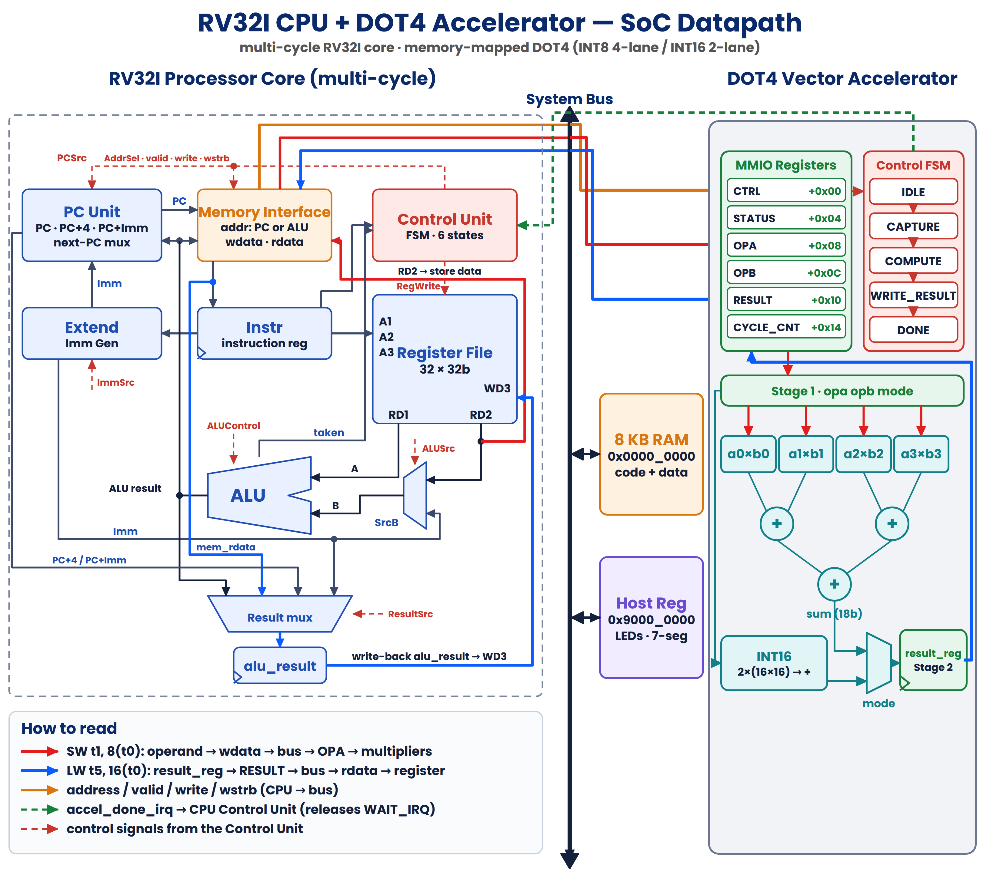
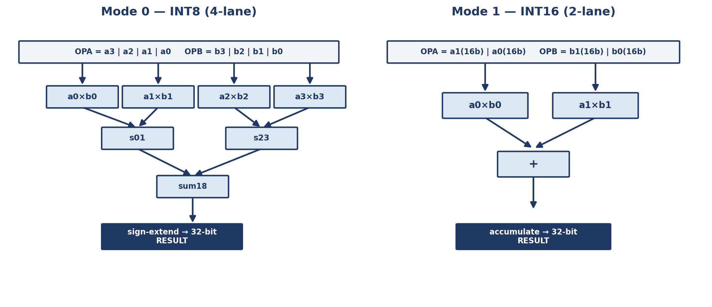
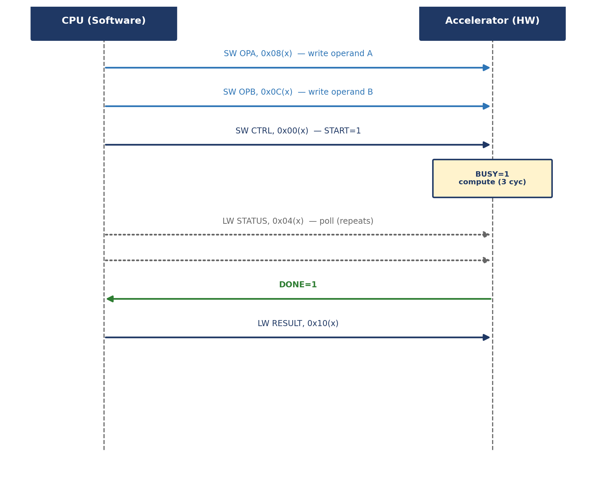
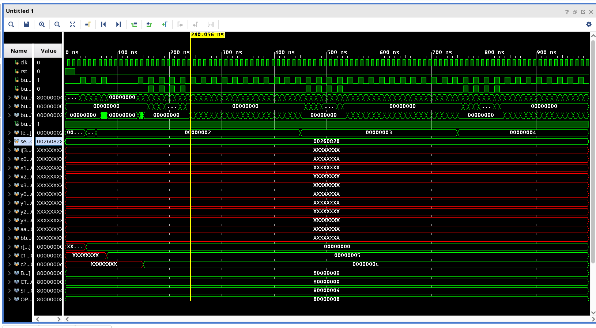

# RISC-V RV32I SoC with Custom DOT4 AI Hardware Accelerator

[](file:///home/heisenberg/Desktop/RiscV_dotAcc_work/rtl)
[](file:///home/heisenberg/Desktop/RiscV_dotAcc_work/rtl/baseline/rv32i_core.v)
[-brightgreen.svg)](file:///home/heisenberg/Desktop/RiscV_dotAcc_work/tb/tb_dot4_accel_top.v)
[](file:///home/heisenberg/Desktop/RiscV_dotAcc_work/verification_report.md)
[](file:///home/heisenberg/Desktop/RiscV_dotAcc_work/verification_report.md)
[](verification_report.md)

An end-to-end engineered, synthesizable **RISC-V System-on-Chip (SoC)** featuring a custom multi-cycle **RV32I CPU core** coupled with **DOT4**, a memory-mapped hardware dot-product acceleration engine supporting **dual-precision INT8 / INT16 vector operations** for edge AI inference.

> 🎓 **Capstone Project** for the **NSHRDP-INSPIRE IC Design & Verification Training Program** (funded by **PSEB**, executed by **GIKI**, trained at **COMSATS Abbottabad**).

---

## ⚡ Key Highlights & Benchmark Results

By offloading the inner-product kernel of matrix multiplication to the dedicated DOT4 hardware engine, the system achieves a **2.89× speedup** over pure software execution on the CPU with **zero modifications to the standard RISC-V instruction set**.

| Metric | Software Baseline (RV32I ALU) | Hardware Accelerated (DOT4 MMIO) | Improvement / Benefit |
| :--- | :---: | :---: | :---: |
| **4×4 Matrix Multiply Latency** | **1,492 clock cycles** | **516 clock cycles** | **2.89× Speedup (65.4% latency reduction)** |
| **Arithmetic Throughput (INT8)** | Sequential ALU iterations | **4 parallel multiplies + 3-add tree** | **400 MOPs** @ 100 MHz |
| **Arithmetic Throughput (INT16)**| Sequential ALU iterations | **2 parallel multiplies + 1-add tree** | **200 MOPs** @ 100 MHz |
| **Accelerator Call Latency** | N/A | **3 clock cycles** (30 ns @ 100 MHz) | Dedicated single/multi-stage execution |
| **ISA Impact** | Standard RV32I | **Zero ISA Changes** | Plain `LW` / `SW` Memory-Mapped I/O |
| **CPU-to-Accel Handshake** | N/A | **Interrupt-Driven** | Zero CPU polling overhead |
| **Verification Assertions** | Unit tests | **208 Assertions (100% Pass)** | Directed boundary + 200 random vectors |
| **Functional Result** | Golden C Reference | **16 / 16 matrix cells exact match** | Verified in Vivado XSim & FPGA |

---

## 🏛️ System Architecture

The SoC integrates the multi-cycle RV32I processor, unified dual-port SRAM, memory-mapped bus interconnect, and the DOT4 acceleration engine into a cohesive architecture.



### 1. RV32I Multi-Cycle CPU Core
- **Architecture**: Complete RV32I base integer instruction set implementation with a clean Finite State Machine (FSM): `FETCH` $\rightarrow$ `DECODE` $\rightarrow$ `EXECUTE` $\rightarrow$ `MEM_ACCESS` $\rightarrow$ `WRITEBACK`.
- **Interrupt Controller**: Hardware interrupt line (`irq_dot4`) directly sampled during state transitions to release processor sleep loops with zero polling overhead.
- **Register File**: 32 general-purpose 32-bit registers with dual read ports and single synchronous write port (`x0` hardwired to zero).

### 2. DOT4 Dual-Precision Vector Accelerator
The DOT4 accelerator performs hardware dot products directly over packed signed integer vectors. Depending on the `MODE` register, it configures into two operational modes:



- **Mode 0 (INT8 × 4-element SIMD)**:
  Unpacks two 32-bit vectors $\mathbf{A} = [a_3, a_2, a_1, a_0]$ and $\mathbf{B} = [b_3, b_2, b_1, b_0]$ into four 8-bit signed multipliers and sums them via a signed adder tree:
  $$\text{Result} = (a_0 \times b_0) + (a_1 \times b_1) + (a_2 \times b_2) + (a_3 \times b_3)$$
- **Mode 1 (INT16 × 2-element SIMD)**:
  Unpacks two 32-bit registers into two 16-bit signed operands and evaluates:
  $$\text{Result} = (a_0 \times b_0) + (a_1 \times b_1)$$

### 3. CPU-to-Accelerator Handshake & MMIO Flow
No custom opcodes or compiler plugins are needed. The accelerator communicates seamlessly over standard memory-mapped load (`LW`) and store (`SW`) instructions:



1. **Load Operands**: CPU writes vector $\mathbf{A}$ to `0x8000_0004` and vector $\mathbf{B}$ to `0x8000_0008`.
2. **Issue Start**: CPU writes `0x0000_0001` to `0x8000_0000` (Control/Status Register).
3. **Hardware Execution**: Accelerator transitions to `BUSY` and executes the dot-product computation in hardware.
4. **Interrupt & Wakeup**: Accelerator fires `irq` to the CPU when done.
5. **Read Result**: CPU reads the 32-bit accumulated sum from `0x8000_000C`.

---

## 🗺️ Memory Map & Register Interface

The interconnect decodes the upper address nibbles into distinct target zones:
- `0x0000_0000` – `0x0000_1FFF`: **8 KB System SRAM** (Code + Data + Stack)
- `0x8000_0000` – `0x8000_0014`: **DOT4 Hardware Accelerator MMIO Space**
- `0x9000_0000`: **UART Transmitter / Host Status Port**

| Register Name | Offset Address | Access | Description / Bitfields |
| :--- | :---: | :---: | :--- |
| **`DOT4_CSR`** | `0x8000_0000` | R/W | **Bit 0**: `START` (Write 1 to trigger)<br>**Bit 1**: `BUSY` (1 = calculation in flight)<br>**Bit 2**: `DONE` (1 = calculation complete)<br>**Bit 3**: `MODE` (0 = INT8 SIMD, 1 = INT16 SIMD) |
| **`DOT4_OPA`** | `0x8000_0004` | R/W | Packed Vector Operand A (Four 8-bit or Two 16-bit signed integers) |
| **`DOT4_OPB`** | `0x8000_0008` | R/W | Packed Vector Operand B (Four 8-bit or Two 16-bit signed integers) |
| **`DOT4_RES`** | `0x8000_000C` | RO | 32-bit Signed Dot-Product Result |
| **`DOT4_CYC`** | `0x8000_0010` | RO | 32-bit Performance Cycle Counter (Tracks accelerator active cycles) |
| **`DOT4_CLR`** | `0x8000_0014` | WO | Write 1 to clear interrupt / acknowledge completion |

---

## 🔬 Comprehensive Verification Suite

The design was verified through a multi-tier verification methodology in **Xilinx Vivado (XSim)**:



### 1. Standalone Accelerator Unit Test (`tb/tb_dot4_accel_top.v`)
- **208 Assertions Evaluated**:
  - **Directed Boundary Vectors**: Maximum positive ($+127$), minimum negative ($-128$), and zero operands in INT8 and INT16.
  - **200 Randomized Test Vectors**: 100 INT8 pseudo-random vectors + 100 INT16 pseudo-random vectors checked cycle-by-cycle against a golden software model.
  - **Busy Lockout & Overflow Protection**: Probing race conditions where operands are written during active execution.
- **Pass Rate: 100.0% (Zero Failures)**.

### 2. Full SoC Integration Benchmark (`tb/tb_riscv_soc_top.v`)
- Executes the real firmware [`sw/dot4_demo.s`](file:///home/heisenberg/Desktop/RiscV_dotAcc_work/sw/dot4_demo.s) compiled with the custom Python assembler [`sw/asm.py`](file:///home/heisenberg/Desktop/RiscV_dotAcc_work/sw/asm.py).
- Performs a **4×4 signed INT8 matrix multiplication** ($C = A \times B$):
```text
  Input Matrix A:               Input Matrix B:               Computed Result Matrix C:
  [  1,  2,  3,  4 ]            [  1,  0,  2,  1 ]            [ 12, 12,  8, 30 ]
  [  2,  1,  0,  1 ]      x     [  0,  1,  1,  2 ]      =     [  4,  2,  6,  8 ]
  [  0,  1,  2,  3 ]            [  1,  2,  0,  3 ]            [  8,  8,  4, 20 ]
  [  1,  1,  1,  1 ]            [  2,  1,  1,  4 ]            [  4,  4,  4, 10 ]
```
- **Result**: All 16 output matrix elements match golden model bit-for-bit.
- Software baseline took **1,492 cycles**. Accelerated execution completed in **516 cycles** (**2.89× speedup**).

---

## 📊 FPGA Hardware Implementation Results

Synthesized and placed on the **Digilent Nexys A7-100T FPGA** (`xc7a100tcsg324-1` Artix-7):

| Resource | Utilization | Available | Utilization % |
| :--- | :---: | :---: | :---: |
| **Slice LUTs** | **3,154** | 63,400 | **4.97%** |
| – *LUT as Logic* | 2,130 | 63,400 | 3.36% |
| – *LUT as Distributed Memory* | 1,024 | 19,000 | 5.39% |
| **Slice Registers (Flip-Flops)** | **1,477** | 126,800 | **1.16%** |
| **DSP48E1 Multipliers** | **2** | 240 | **0.83%** |
| **Bonded IOB Pins** | **20** | 210 | **9.52%** |
| **Global Clock Buffers (BUFG)** | **1** | 32 | **3.13%** |

- **Total On-Chip Power**: **110 mW (0.110 W)** (Dynamic: 12 mW, Static: 97 mW)
- **Physical Verification**: Board tested with 115200 baud UART output transmitting `"PASS: OK!\r\n"` and onboard status LEDs.

---

## 📁 Repository Structure

```text
├── rtl/
│   ├── baseline/                # Original architecture
│   │   ├── rv32i_core.v         # Multi-cycle RV32I processor core
│   │   ├── dot4_datapath.v      # Dual-mode dot-product datapath
│   │   ├── dot4_accel_top.v     # Accelerator FSM and MMIO registers
│   │   ├── riscv_soc_top.v      # Top-level integrated SoC
│   │   ├── ram.v                # Dual-port behavioral RAM model
│   │   └── uart_tx.v            # Serial UART transmitter
│   └── optimized/               # High-frequency timing-closed RTL
│       ├── rv32_dot4_system.v   # Synthesizable 3-block top-level
│       ├── rv32i_core_fast.v    # Decoupled core with precomputed branch targets
│       ├── dot4_datapath_pipelined.v # 2-stage pipelined multiplier/adder tree
│       └── dot4_accel_top_fast.v # Multi-cycle path accelerator FSM
├── tb/
│   ├── tb_dot4_accel_top.v      # 208-assertion accelerator unit testbench
│   ├── tb_riscv_soc_top.v       # Full SoC 4x4 matrix multiplication testbench
│   └── tb_rv32_dot4_system.v    # Top-level frontend verification bench
├── sw/
│   ├── dot4_demo.s              # RISC-V assembly matrix multiplication firmware
│   ├── dot4_demo.c              # Reference C implementation
│   ├── asm.py                   # Custom two-pass Python assembler
│   └── program.hex              # Assembled hex image preloaded into SRAM
├── docs/
│   └── images/                  # High-resolution architectural schematics & waveforms
└── verification_report.md       # Detailed empirical verification and FPGA metrics
```

---

## 🚀 Quickstart: Running Simulations

### Prerequisites
- **Xilinx Vivado (2019.1 or newer)** or open-source simulator (**Icarus Verilog** / **Verilator**)
- Python 3.8+ (for assembling firmware)

### 1. Assemble Firmware (Optional)
```bash
cd sw
python3 asm.py dot4_demo.s program.hex
```

### 2. Run Standalone Accelerator Verification (208 Assertions)
Using Icarus Verilog:
```bash
iverilog -g2012 -o sim_accel rtl/baseline/dot4_datapath.v rtl/baseline/dot4_accel_top.v tb/tb_dot4_accel_top.v
vvp sim_accel
```

### 3. Run Full SoC Matrix Multiplication Simulation
Using Xilinx Vivado (Batch mode):
```bash
xvlog -sv rtl/baseline/*.v tb/tb_riscv_soc_top.v
xelab -debug typical tb_riscv_soc_top -s soc_sim
xsim soc_sim -R
```

---

## 🔮 Upcoming in Part 2: ASIC Physical Design (RTL-to-GDSII)

> 💡 *Stay tuned! In Part 2 of this series, we will showcase the complete **ASIC Backend Physical Design Flow**:*
> - **Logic Synthesis**: Cadence Genus on **TSMC 0.18µm (180nm)** technology (`tsmc18_6lm`).
> - **Timing Closure**: Optimization from baseline 248 MHz to **350 MHz signoff** ($WNS \ge 0\text{ ps}, TNS = 0.0\text{ ps}$).
> - **Place & Route (PnR)**: Cadence Innovus floorplanning, power rings/stripes, CTS, NanoRoute, and final GDSII layout.
> - **Gate-Level Simulation (GLS)**: Post-synthesis timing simulation at 350 MHz.

---

## 👥 Acknowledgments

- **Instructors & Mentors**: Deep gratitude to our respected trainers and instructors for their guidance in computer architecture and digital verification.
- **Institutions**: **GIKI (Ghulam Ishaq Khan Institute of Engineering Sciences and Technology)** and **PSEB (Pakistan Software Export Board)** for organizing the **NSHRDP-INSPIRE IC Design & Verification Program**.
- **Host Institution**: **COMSATS University Islamabad, Abbottabad Campus** for hosting the training program.

---

## 📜 License

This project is licensed under the [MIT License](LICENSE) - see the LICENSE file for details.

